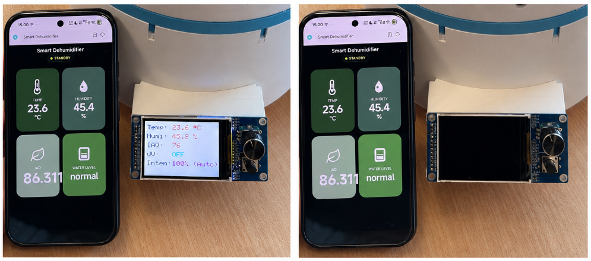
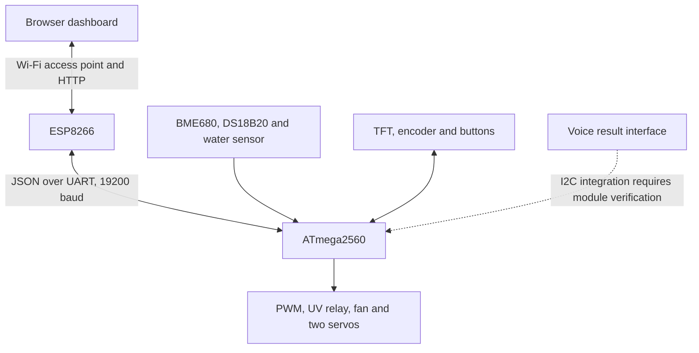

# Xiaoshi — Smart Dehumidification Cabinet

An embedded cabinet prototype for controlling humidity in small enclosed storage spaces. It combines silica-gel desiccant handling and thermoelectric condensation with local controls, a browser dashboard and voice-control interfaces.

An **ATmega2560** handles sensors, actuator commands and the display. An **ESP8266** hosts the web dashboard over its own Wi-Fi access point and exchanges newline-delimited JSON with the main controller.



*Original prototype photographs extracted from the project presentation. The repository preserves implementation and design materials; it does not claim a newly measured dehumidification or purification performance result.*

## Start here

| Interest | Reading entry point |
|---|---|
| Main control loop, PID logic and hardware I/O | [ATmega2560 firmware](firmware/mega2560/README.md) |
| Wi-Fi firmware, HTTP routes and serial bridge | [ESP8266 firmware](firmware/esp8266/README.md) |
| HTML, CSS, JavaScript and SVG interface assets | [Web dashboard](web/README.md) |
| PCB project, native CAD assemblies and printable meshes | [Hardware](hardware/README.md) |
| Voice command phrases, original template and module notes | [Voice module](voice/README.md) |
| Controller-to-controller message contract | [Serial and HTTP protocol](docs/protocol.md) |
| English project slides and demonstration | [Project materials](docs/README.md) |
| What was checked and what remains unverified | [Validation](docs/validation.md) |

## What the project implements

- Environmental sensing with **BME680/BSEC**, Peltier temperature sensing with **DS18B20**, and analog water-level monitoring.
- Humidity-demand PID and temperature-based power limiting. The requested dehumidifier level and the actual temperature-limited PWM output are separate quantities in the main firmware.
- UV and fan relay commands, a **ST7789 TFT**, encoder menu, standby/wake controls and EEPROM-backed settings/calibration state.
- A timed, non-blocking **two-servo desiccant replacement sequence**.
- An ESP8266 SoftAP with a LittleFS-hosted, mobile-oriented **HTML/CSS/JavaScript dashboard**, status polling and high-level command routes.
- Preserved electronics, mechanical, voice and demonstration materials with concise English reading guides.

The UV/TiO₂ layer is an auxiliary design feature described in the source presentation. No measured sterilization, pollutant-removal or health-effect claim is made here.

## Architecture



The ESP8266 is the network/interface layer. The ATmega2560 calculates physical outputs. Some web values are optimistic local control values rather than hardware acknowledgements; the [protocol guide](docs/protocol.md) explains that boundary.

## Explore the dashboard without hardware

From the repository root, with Python 3.10 or newer:

```bash
python3 tools/preview_server.py
```

Open **http://127.0.0.1:8080**. This serves the actual web files with an explicit **synthetic-data preview banner**. It opens no serial port and controls no appliance. The preview helper was added during repository preparation, so its behavior is not evidence of a new hardware experiment.

The original USB-to-TTL serial simulator is also included as [`tools/mock_serial.py`](tools/mock_serial.py); see the [tools guide](tools/README.md) for hardware-connected diagnostic use.

## Build the supplied firmware

With PlatformIO Core installed, run from the repository root:

```bash
pio run -d firmware/mega2560
pio run -d firmware/esp8266
pio run -d firmware/esp8266 -t buildfs
```

The ESP8266 project points `data_dir` to the single shared `web/` directory. Its firmware **and LittleFS image** are both needed on the device for the full interface. Upload commands and wiring are in the module guides; no device flashing was performed during repository preparation.

## Verification

| Check | Result |
|---|---|
| ATmega2560 firmware | Compile/link passed; 5,257 bytes RAM and 91,654 bytes flash in the recorded environment |
| ESP8266 firmware | Compile/link passed; 32,984 bytes RAM and 343,283 bytes flash |
| Web filesystem | LittleFS image built successfully from the supplied dashboard files |
| Host command/reference checks | 4 Python checks passed; Python and JavaScript syntax checks passed |
| Original design/source coverage | File dispositions and preserved-file hashes checked locally |

See [validation.md](docs/validation.md) for actual toolchain versions, test scope and remaining hardware checks. No humidity-response curve, water collection rate, energy efficiency, voice-recognition accuracy or purification efficacy was newly measured.

## Recognition

**Second Prize — 2025 “Keyou Cup”, 4th Jiangsu Provincial University Intelligent Robot Creativity Competition.** This is an English translation of the title on the supplied project award certificate. The certificate image and participant names are intentionally not published in this repository.

## Materials and scope

Native SolidWorks parts/assemblies retain their original filenames so internal references can remain resolvable. All distinct meshes are preserved; dated names do not establish which version was manufactured. The original voice workbook retains its vendor-format Chinese headers and an English CSV explains its command data.

The supplied voice binary, retained locally pending redistribution permission, is labeled UART/115200, while the main firmware reads voice results over I²C. The matching module configuration is not established by these files alone. The [voice guide](voice/README.md) also records command-index discrepancies without inventing a replacement firmware.

The [project presentation](docs/presentation/project_overview.pptx) retains the technical content with names/student identifiers removed from editable text. The original demonstration video is provided separately as a release asset. No claim of sole authorship is made for the supplied project materials, and no repository-wide open-source license has been added; see [third-party notices](THIRD_PARTY_NOTICES.md).
