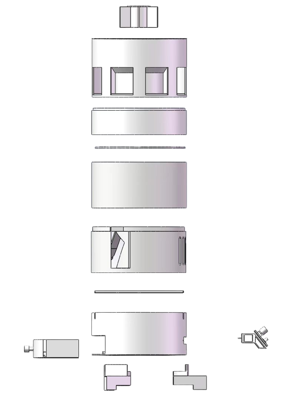

# Electronics and mechanical design

## Electronics

`pcb/dehumidifier.epro2` is the supplied editable JLC/“EasyEDA Pro” project, renamed from `JLCpcbDesign.epro2`. No Gerber fabrication set, independently checked BOM or measured electrical test log was present in the archive. The project file is preserved without redesign; use a compatible editor to inspect its schematic/layout.

The [main-controller guide](../firmware/mega2560/README.md) lists the actual source pin definitions. Mega `Serial2` uses TX2 16 and RX2 17 at 19200 baud; ESP8266 code uses its primary hardware serial. Account for actual module power, crossed TX/RX, common ground and the Mega/ESP8266 logic-voltage difference when inspecting the physical interface. The repository does not establish which level-conversion circuitry was fitted.

The presentation describes a layered cabinet with silica-gel handling, airflow, UV/TiO₂, thermoelectric condensation and an electronics/control layer. Those are prototype design features rather than independently verified electrical isolation or purification ratings.

## Mechanical files

`mechanical/` preserves **all 46 distinct original files**:

- 20 native SolidWorks part files (`.SLDPRT`).
- 3 native SolidWorks assemblies (`.SLDASM`).
- 23 STL mesh exports.

Native filenames, spelling, capitalization and their shared flat directory are retained so assembly references have the best chance of remaining resolvable. The three assemblies are `total.SLDASM`, `lowestLayerTotal.SLDASM` and `silicaGelLayerTotal.SLDASM`.

The files cover the enclosure/layers, desiccant mechanism, fan/TEC adapters, display holder, inlet, UV section, water tank and associated fixtures. Dated/variant STL files with equal sizes are not necessarily duplicates: their hashes differ, so all are retained. No version was selected solely from a date-like filename.

Original assembly references may depend on a particular SolidWorks version or external geometry not exported separately. File preservation is not a mechanical fit check. No geometry, tolerances, materials, printing settings or manufacturing dimensions were modified or validated during preparation.
